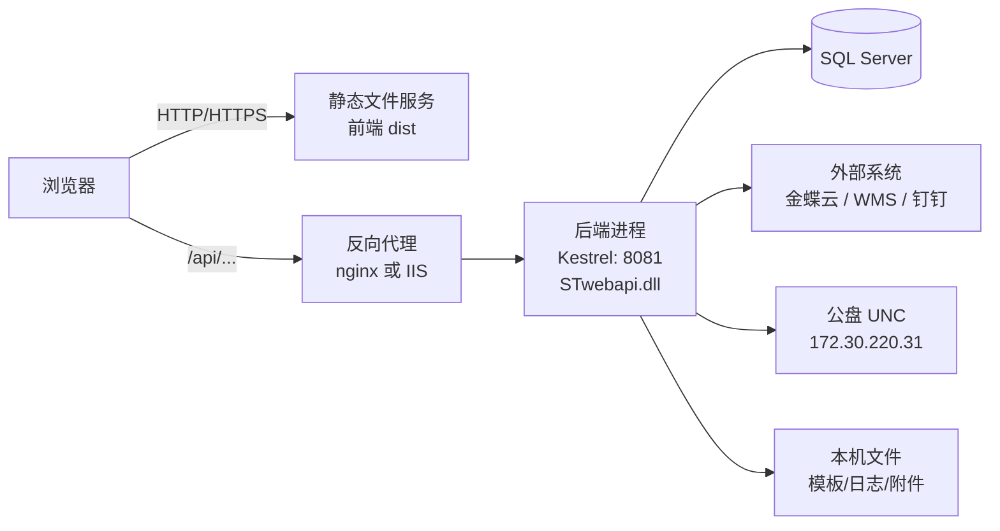

# MES 系统部署运维手册（Windows Server / Linux Server）

- 对象：`STwebsiteFrontEnd_V1`（前端）、`STBackEnd`（后端 API + 打印服务）、SQL Server 数据库
- 读者：未来的你一个人（开发 + 部署 + 运维）
- 编写方式：全部结论从代码/产物取证，逐条标注证据等级（看第 13 节）
- 最后更新：2026-10-08

---

## 0. 先记住这 8 条（能省大量排错时间）

1. 后端进程的**工作目录（CWD）必须等于发布目录**，否则模板、`Config/*.json`、`appsettings.json`、日志全部找错地方（代码里到处是 `./xxx` 相对路径）。
2. 生产**必须显式给监听地址**（`ASPNETCORE_URLS`），否则默认监听 5000；`launchSettings.json` 里的 `127.0.0.1:8081` 只在开发时生效。
3. `appsettings.json` **运行时会被程序写回**（单号/ID 计数器），所以它必须可写，而且这套系统**只能单实例部署**。
4. 前端生产构建的接口基址是 `/api`（绝对路径），**前端和 API 必须同域**（靠反向代理），否则 CORS 会因为白名单写死 `http://localhost:9527/` 而全挂。
5. `appsettings.json` 里 `TestEnvironment` 当前是 `true`，正式部署前必须确认这个值。
6. 服务器时区必须是 `UTC+8`，因为日志和业务时间都用 `DateTime.Now`，历史上出过"上下老化时间与实际时间不一致"的 bug。
7. `net use` + `cmd.exe` 建公盘凭据（PD 数据上传、站点状态上传）**只能在 Windows 上跑**；打印服务也是 Windows 专属。
8. 生产**绝对不要用 `dotnet run`** 起服务（会把配置写回，造成配置漂移），用发布产物 + 服务/进程守护。

---

## 1. 概念扫盲（没做过 Web 部署先看这节）

### 1.1 "部署"到底在做什么

开发时你敲一个命令，程序在前台跑，配置在源码目录里，坏了看控制台。
部署就是把同样这个程序搬到服务器上，让它：
1. **后台长期运行**（关掉远程桌面也活着）；
2. **开机自启、崩溃自愈**；
3. **配置和源码分离**（改配置不动程序）；
4. **只开放必要端口**，其余收在防火墙后面；
5. **可重复**（下次发布照抄流程，不靠手感和记忆）。

### 1.2 这套系统由四层组成



- **前端**编译出来是一堆 `html/js/css`（纯静态文件），不需要 .NET、不需要 Node，扔给任意 Web 服务器都能跑。
- **后端**才是真正的程序（ASP.NET Core），对外提供 `/api/xxx` 接口。
- 两者用**同一个域名同一个端口**对外（这就是"同域"），靠反向代理把 `/api/` 分给后端、其余分给前端。

### 1.3 两种托管方式（后面两条路线就是它）

| 方式 | 是什么 | 特点 |
| --- | --- | --- |
| 自托管（Kestrel） | 直接跑 `STwebapi.exe` / `dotnet STwebapi.dll`，再用 NSSM（Windows）或 systemd（Linux）看住它 | **工作目录可控**（这点对本项目极重要）、配置直观、跨平台一致 |
| IIS 承载 | 用 IIS 调 ASP.NET Core Module 拉起进程 | Windows 传统做法，能顺便用 IIS 做站点/证书；但工作目录和权限更容易出坑 |

### 1.4 反向代理是什么、为什么必须有

反向代理（nginx / IIS 的 URL Rewrite+ARR）站在最前面接客，按路径转发：

- `https://mes.xxx.com/` -> 前端静态文件
- `https://mes.xxx.com/api/...` -> `http://127.0.0.1:8081/api/...`

好处：① 前后端同域，绕开 CORS；② HTTPS 只在反代上配一次；③ 后端端口只监听本机，不对外暴露；④ 以后换端口/换机器，前端不用改一行代码。

### 1.5 两个必须知道的环境变量

| 变量 | 作用 | 生产建议值 |
| --- | --- | --- |
| `ASPNETCORE_ENVIRONMENT` | 决定加载哪个 `appsettings.{环境}.json`，决定是否显示详细错误页 | `Production` |
| `ASPNETCORE_URLS` | 进程监听地址 | `http://127.0.0.1:8081`（只在反代后面时）或 `http://0.0.0.0:8081`（直接对外） |

### 1.6 "发布"和"运行"是两件事

- **发布**（`dotnet publish`）：把编译结果 + 依赖 dll + 配置 + 模板整理成一个可以直接拷走的目录。
- **运行**：在那个目录里启动进程。
- 发布可以在你的开发机上做，做完把目录整个拷到服务器 -> 服务器上**甚至不需要装 SDK**（只需运行时）。

### 1.7 为什么这套系统只能单实例

后端启动时会读 `appsettings.json` 里的一组 `SeedOffset_*`（单号/ID 计数器），并在运行中把新值**写回同一个文件**（[确证] `STCommon/Seed.cs:47` 构造 `JsonFileHelper("appsettings")`；`STCommon/Seed.cs:139-144` 调用 `_jsonFileHelper.Write("SeedOffset_...")`；`STCommon/JsonFileHelper.cs:141` 直接 `new StreamWriter(_path)` 覆盖写）。
两个进程同时跑 -> 各自持有自己的内存计数 -> **单号撞车或跳号**。所以：单实例、不要做负载均衡、发布时先停后起。

---

## 2. 系统组成清单

| 组件 | 位置 | 技术栈 | 目标框架 | 能否 Linux |
| --- | --- | --- | --- | --- |
| 后端 API（主角） | `STBackEnd/src/STwebapi` | ASP.NET Core + Autofac + EF Core 6 | `net6.0`（[确证] `STwebapi.csproj:4`） | 能（除公盘功能） |
| 业务层 | `STWebService`、`STProcedure`、`STRules` 等 | 类库 | `net6.0` | 能 |
| 前端 | `STwebsiteFrontEnd_V1` | Vue 2.6.10 + Element UI + vue-admin-template 4.4.0 | Node | 能（构建产物是静态文件） |
| 打印服务（新） | `STBackEnd/src/STMESPrintService` | Worker Service + `HttpListener`（[确证] `Worker.cs:20`） | `net7.0`（[确证] csproj:4） | 不行（见下） |
| 打印服务（旧） | `STBackEnd/src/STMESPrintServiceFW` | Windows Service（[确证] `Service.cs:8 ServiceBase`） | **.NET Framework 4.8**（[确证] csproj:11） | **完全不行** |
| 其它桌面工具 | `STAPIDemo`（WinForms）、`STClassAnalysisTool` | `net7.0-windows` / `net6.0` | - | STAPIDemo 不行 |
| 数据库 | 外部 | SQL Server（`Microsoft.Data.SqlClient`） | - | 能（SQL Server on Linux） |
| 外部依赖 | - | 金蝶云（公网 https）、WMS 接口、钉钉、公盘 `\\172.30.220.31\...` | - | 需网络可达 |

---

## 3. Windows / Linux 可行性对照（先看这张表再决定买哪台机器）

| 能力 | Windows Server | Linux Server | 依据 |
| --- | --- | --- | --- |
| 后端 API | 可以 | 可以 | 代码是跨平台 ASP.NET Core |
| 前端静态站点 | 可以（IIS） | 可以（nginx） | 纯静态文件 |
| SQL Server | 可以 | 可以（或连 Windows 上的库） | - |
| PD 数据上传公盘（UNC 建凭据） | 可以 | **不行（会抛异常/静默失败）** | [确证] `STWebService/PivotTable/ExcelExportService.cs:648` `FileName = "cmd.exe"`、`:657` 拼 `net use ...`；`STWebService/SiteStatus/SiteStatusService.cs:2701/2710` 同样 |
| 站点状态上传公盘 | 可以 | **不行** | 同上 |
| Excel 导出 | 可以 | 可以（但要装 `libgdiplus`，见 7.1） | 用了 Spire.XLS / NPOI / SkiaSharp |
| 打印服务 | 可以 | **不行** | `STMESPrintServiceFW` 是 .NET Framework |
| 钉钉推送 | 可以 | 可以 | 纯 HTTP |

**结论**：
- 如果要**完整保留**公盘上传 + 打印，生产环境只能是 **Windows Server**。
- 如果上 Linux，等于宣布"PD 自动处理上传公盘、站点状态上传、打印"这三个功能废掉（除非改代码，见 7.5）；后端 + 前端 + 数据库本身没问题。

---

## 4. 部署前配置清单

### 4.1 配置文件总表（**密钥类值我不抄，只写位置和注意事项**）

| 文件 | 关键键 | 作用 | 生产注意事项 |
| --- | --- | --- | --- |
| `STwebapi/appsettings.json` | `ConnectionStrings.DefaultConnection` / `.TestDataConnection` | 数据库连接串 | 值是**加密串**（不是明文），不能手写明文去替换；换库必须用项目原有的加密方式重新生成（[确证] 值形如长 base64，`Config` 里的 `DESkey` 相关方法在 `STCommon/SystemConfig.cs`） |
| 同上 | `TestEnvironment` | 测试/正式开关 | 当前是 `true`（[确证] `appsettings.json:1` 同一行有该键）。改前先全局搜 `TestEnvironment` 看它影响到哪些分支 -> [未验证] 我只确认键存在，**没有逐个方法读完 true/false 的行为差异** |
| 同上 | `PDTestDataBasePath` / `PDTestDataResultPath` | PD 数据源/结果目录（UNC 公盘） | 服务器必须能访问 `\\172.30.220.31\...`；UNC 凭据由代码里的 `net use` 建立，账号密码在同文件的加密键里 |
| 同上 | `WaferQualUploadAccount` / `ShortPulseRBUploadAccount` 等 | 公盘上传账号（值加密） | 服务运行账号必须能用这套凭据连上网盘 |
| 同上 | `SeedOffset_*`（7 个） | 单号/ID 种子 | **运行时会写回本文件** -> 必须可写；发布/备份时必须把它一起带走 |
| 同上 | `AttachMentBaseFolder` / `ChartBaseFolder` | 附件、图表根目录 | [确证] `STCommon/Seed.cs:61-62` 读取，值我没打印；生产要指向真实存在的目录 |
| 同上 | `InterfaceConfig` | 外部接口配置 | **含明文账号密码**（[确证] 我读到过 `UserName`/`Password`/`Token` 明文）-> 按密码对待 |
| `STwebapi/appsettings.Development.json` | 同上一批键 | Development 环境**覆盖**主配置 | **生产不要部署这个文件**；并且确认 `ASPNETCORE_ENVIRONMENT` 不是 `Development`（[确证] 该文件里有测试账号与 `TestEnvironment: true`） |
| `STwebapi/Config/appsettings.json` | `X-KDApi-*` | 金蝶云接口（[确证] `Program.cs` 未加载它，是 `KDPlugin` 自己按相对路径读，见 `KDPlugin.csproj:24`） | 含 AppID/AppSec **明文**，等于密码；`Config/appsettings -测试环境.json` / `-正式环境.json` 只是**留档，不会自动生效**，用哪个就把它改名成 `appsettings.json` |
| `STwebapi/Config/PDTestSpecRules.json` | PD 判定规则 | 业务规则 | [确证] `Program.cs:40` 用 `reloadOnChange: true` 注册 -> **改规则不用重启**；但同处写了 `optional: true` -> 文件丢了也不报错，会静默失效，所以改完必须验证 |
| `STwebapi/Config/WMSPluginSettings.json` | - | WMS 接口配置 | 随发布产物走 |
| `STwebapi/Resources/Template/*.xlsx` | - | 4 个 Excel 模板 | [确证] 会自动复制到产物目录（`bin/Debug/net6.0/Resources/Template/` 下确实有 xlsx）；但**发布后要人工核对 4 个文件齐全**（我看到的产物里只有 3 个，属于旧构建残留） |
| `STCommon/SystemConfig.cs` | `DESkey` / `WebUserDESkey` / `DeviceDESkey` | 加解密密钥、模板相对路径 | 密钥**硬编码在代码里**（[确证] `SystemConfig.cs:14-16`）-> 换环境换密钥要重新编译；同文件 `:17-31` 全是 `./Resources/...` 相对路径（CWD 坑的根源） |

### 4.2 发布产物必须包含

```
STwebapi.dll / STwebapi.exe          主程序 + apphost
*.dll                                依赖（含 STxxx.dll、KDPlugin.dll、WMSPlugin.dll 等）
STwebapi.runtimeconfig.json / .deps.json / .staticwebassets.endpoints.json
appsettings.json                     【必须可写】
Config/                              appsettings.json(金蝶) + PDTestSpecRules.json + WMSPluginSettings.json + 两套留档
Resources/Template/*.xlsx            4 个模板
Resources/WaferQualData/             运行时可写（程序自己创建）
Resources/PDWatTestData/             运行时可写（程序自己创建）
log/  requestlog/                    运行时可写（日志）
Attachments/  Charts/                运行时可写（附件/图表）
web.config                           仅 IIS 托管需要（[推断] `dotnet publish` 由 Web SDK 自动生成；仓库里没有手写的 web.config [确证]）
```

### 4.3 权限要求一句话

**发布目录对运行账号必须"可写"**，不只是可读：要写 `appsettings.json`、`log/`、`Resources/*Data/`、`Attachments/`、`Charts/`。

---

## 5. 8 个坑（每条都有出处，遇到怪事先查这张表）

| 编号 | 坑 | 后果 | 依据 |
| --- | --- | --- | --- |
| 1 | **相对路径依赖 CWD** | 找不到模板 -> 导出失败；日志写到别处；甚至写错 `appsettings.json` | [确证] `SystemConfig.cs:17-31`、`Logger.cs:11`（`"./log/log{0}.txt"`）、`Seed.cs:47`（`JsonFileHelper("appsettings")`） |
| 2 | **IIS / Windows 服务的默认工作目录不是发布目录** | 症状同 1，且极难发现 | [推断] IIS 默认 CWD 为系统目录、Windows 服务默认 `C:\Windows\System32`（这是通用行为，我没在本项目实测） |
| 3 | **不设 `ASPNETCORE_URLS` 就监听 5000** | 前端连不上、本以为在 8081 | [确证] 全仓 `src` 下没有 `UseUrls`/`Kestrel` 配置（grep 0 命中）；[确证] 8081 只出现在 `Properties/launchSettings.json`（开发专用） |
| 4 | **CORS 白名单写死 `http://localhost:9527/`** | 前后端不同域时浏览器全部报 CORS 错误 | [确证] `Startup.cs:54` |
| 5 | **`TestEnvironment` 当前为 `true`** | 可能走测试分支（例如跳过公盘上传） | [确证] 键存在于 `appsettings.json`；[未验证] 具体行为差异我没读完 |
| 6 | **`appsettings.json` 不可写** | 单号递增时抛异常（`JsonFileHelper.Write` 是 `throw ex`，不吞异常） | [确证] `STCommon/JsonFileHelper.cs:148-151` |
| 7 | **`appsettings.Development.json` 被带到生产 / 环境变量仍是 Development** | 配置被测试值悄悄覆盖；详细错误页暴露堆栈 | [确证] 文件存在且含测试凭据；[确证] `Startup.cs:182` 有 `UseDeveloperExceptionPage`（[推断] 它应包在 `IsDevelopment()` 判断里） |
| 8 | **多实例 / 负载均衡** | 单号撞车（见 1.7） | [确证] `Seed.cs:139-144` + `JsonFileHelper.cs:141` |

另外两条"写下来提醒自己"：
- 生产别用 `dotnet run`（会把配置写回，导致仓库配置漂移）。
- 发布用 `Release`，别用 csproj 里自定义的 `DEVELOP`（[确证] `STwebapi.csproj:6` `Debug;Release;DEVELOP`，`:19-21` DEVELOP 会定义编译常量）。

---

## 6. Windows Server 部署

### 6.1 装运行时

1. 装 **ASP.NET Core 6.0 Runtime**（若走 IIS，装 **Hosting Bundle**，它含运行时 + ANCM）。
2. 验证：`dotnet --list-runtimes` 里要有 `Microsoft.AspNetCore.App 6.0.x`。
3. 时区：控制面板设为 `(UTC+08:00) 北京`，或命令行 `tzutil /s "China Standard Time"`。

### 6.2 发布（在开发机做）

```powershell
cd e:\workSpace\STMES_Repository\STBackEnd
dotnet publish src\STwebapi\STwebapi.csproj -c Release -o D:\Publish\MESAPI
```

产物目录里会生成 `STwebapi.exe`（[确证] 本机 `bin\Debug\net6.0\` 下已有该 exe）。

### 6.3 落盘

- 建议 `D:\MES\api\`（不要放 `C:\Program Files` 之类需要管理员权限的路径）。
- 整个发布目录拷过去，并确认：
  - `appsettings.json` 是**正式**那份（不是开发机上的测试配置）；
  - **删掉** `appsettings.Development.json`；
  - `Config\appsettings.json` 是正式的金蝶配置；
  - `Resources\Template\` 下 4 个 xlsx 齐全；
  - 手工建好（若不存在）`log\`、`requestlog\`、`Attachments\`、`Charts\`、`Resources\WaferQualData\`、`Resources\PDWatTestData\`。

### 6.4 授权

```powershell
icacls "D:\MES\api" /grant "MES_APP:(OI)(CI)M"
```
（把 `MES_APP` 换成实际运行账号；权限不足最先坏的就是 `appsettings.json` 和 `log\`。）

### 6.5 起进程

#### 路线 A（**推荐**）：NSSM 包一层

为什么不用 `sc.exe` 直接注册：ASP.NET Core 进程要和 SCM 通信必须引用 `Microsoft.Extensions.Hosting.WindowsServices`，而**本项目没有引用**（[确证] 全仓 grep 只在 `STMESPrintService` 里命中，`STwebapi` 没有）-> 直接用 `sc create` 大概率"服务启动失败/1053"。

```powershell
nssm install MESAPI D:\MES\api\STwebapi.exe
nssm set MESAPI AppDirectory D:\MES\api
nssm set MESAPI AppEnvironmentExtra ASPNETCORE_ENVIRONMENT=Production ASPNETCORE_URLS=http://127.0.0.1:8081
nssm set MESAPI AppStdout D:\MES\api\log\stdout.log
nssm set MESAPI AppStderr D:\MES\api\log\stderr.log
nssm set MESAPI Start SERVICE_AUTO_START
nssm start MESAPI
```

`AppDirectory` 那一行**就是解掉坑 1/2 的关键**，别漏。

#### 路线 B：IIS + ASP.NET Core Module

1. 装 Hosting Bundle；IIS 里建站点指向 `D:\MES\api`。
2. 应用程序池 -> **无托管代码**，标识设成能读写发布目录、能访问公盘的账号。
3. `web.config` 由发布自动生成（`<aspNetCore processPath="dotnet" arguments=".\STwebapi.dll" />`），**不要手写覆盖**。
4. 注意：代码里显式开了同步 IO（[确证] `Startup.cs:153 options.AllowSynchronousIO = true`），这是为了兼容 IIS 承载，**别删**。
5. IIS 承载下如果仍出现"找不到 ./Resources/..."，就是工作目录问题 -> 老实回去用路线 A。

### 6.6 前端站点 + 反向代理

- 把前端 `dist\` 拷到 `D:\MES\web\`。
- 目标：`/` 给静态文件，`/api/` 转给 `http://127.0.0.1:8081`。
- IIS 做法：装 **URL Rewrite** + **ARR**，建 URL Rewrite 反向代理规则（`/api/(.*)` -> `http://127.0.0.1:8081/api/{R:1}`）。
- 更省事的做法：Windows 上装 nginx，配置直接抄第 7.4 节。

**重要**：后端路由前缀本身就是 `/api`（[确证] `Startup.cs:201-203` `MapControllerRoute(pattern: "api/{controller=Home}/{action=Index}/")`，`MapControllers()` 被注释掉），所以转发时**原样透传 `/api` 前缀**，不要再剥一层。

### 6.7 防火墙

```powershell
netsh advfirewall firewall add rule name="MES Web 80" dir=in action=allow protocol=TCP localport=80
```
- 只开 80/443（给反代用）。`8081` 若只被本机反代访问，**不要**对全网开。
- 公盘要能通：`ping 172.30.220.31`、`dir \\172.30.220.31\Vertilite.com`（用运行账号的身份测，不是管理员身份）。

### 6.8 上线自检

1. `nssm status MESAPI` / 任务管理器里 `STwebapi.exe` 在；
2. 服务器本机 `curl -i http://127.0.0.1:8081/api/<控制器>/<动作>` -> 能返回 JSON 或 401（说明进程活着、路由通）；具体控制器名以你的代码为准（[未验证] 我没有逐个核对接口路径）；
3. 浏览器打开站点 -> 登录 -> 随便查一个列表；
4. 看 `log\log<今天>.txt` 有没有新内容；
5. 触发一次 Excel 导出 / PD 处理（验证模板与目录权限）；
6. 重启服务器，确认服务自动起来。

---

## 7. Linux Server 部署

### 7.1 装 .NET 6

```bash
# 以 Ubuntu 为例（微软官方源，详细步骤以微软文档为准）
sudo apt-get update
sudo apt-get install -y dotnet-runtime-6.0 aspnetcore-runtime-6.0
dotnet --list-runtimes
sudo timedatectl set-timezone Asia/Shanghai
```

如果要用到 Excel/图表渲染，可能还需要 `libgdiplus`（Spire.XLS/NPOI 的 Linux 依赖）：
```bash
sudo apt-get install -y libgdiplus libc6-dev
```
（[推断] 是否必须取决于具体导出实现，本项目 `Resources`/`Charts` 相关代码我没逐个读完 -> 上线前实测导出功能。）

### 7.2 发布与拷贝

两种都行：
- 在 Windows 开发机 `dotnet publish -c Release -o ./publish`，再把目录拷到服务器（框架依赖模式下两边可通用，前提是服务器装了 .NET 6 运行时）；
- 直接在服务器上 `dotnet publish`（要装 SDK）。

```bash
sudo mkdir -p /opt/mes/api && sudo cp -r ./publish/* /opt/mes/api/
sudo rm -f /opt/mes/api/appsettings.Development.json
sudo chown -R mesapp:mesapp /opt/mes/api
```

### 7.3 systemd 服务

`/etc/systemd/system/mes-api.service`：

```ini
[Unit]
Description=STMES Web API
After=network.target

[Service]
WorkingDirectory=/opt/mes/api
ExecStart=/usr/bin/dotnet /opt/mes/api/STwebapi.dll
Restart=always
RestartSec=5
User=mesapp
Group=mesapp
Environment=ASPNETCORE_ENVIRONMENT=Production
Environment=ASPNETCORE_URLS=http://127.0.0.1:8081
Environment=DOTNET_PRINT_TELEMETRY_MESSAGE=false

[Install]
WantedBy=multi-user.target
```

```bash
sudo systemctl daemon-reload
sudo systemctl enable --now mes-api
sudo systemctl status mes-api
journalctl -u mes-api -n 100 --no-pager     # 起不来先看这里
```

`WorkingDirectory` 与启动参数里的路径都要写对，这是坑 1/2 在 Linux 上的对应解药。

### 7.4 nginx（前端 + 反代）

```nginx
server {
    listen 80;
    server_name mes.example.com;

    root /opt/mes/web;              # 前端 dist 内容
    index index.html;

    # 前端是 hash 路由（[确证] src/router/index.js 里 mode: 'history' 被注释），
    # 所以理论上不需要 try_files 兜底；加上也无害，稳一点。
    location / {
        try_files $uri $uri/ /index.html;
    }

    # API 原样透传 /api 前缀（后端路由模板本身带 api/）
    location /api/ {
        proxy_pass http://127.0.0.1:8081;
        proxy_http_version 1.1;
        proxy_set_header Host $host;
        proxy_set_header X-Real-IP $remote_addr;
        proxy_set_header X-Forwarded-For $proxy_add_x_forwarded_for;
        proxy_set_header X-Forwarded-Proto $scheme;
        proxy_read_timeout 300s;    # 导出/大批量接口慢，别用默认 60s
        client_max_body_size 100m;  # 有附件上传就放宽
    }
}
```

因为前端和后端同域，第 5 节的 CORS 坑（`Startup.cs:54`）自然绕过。

### 7.5 Linux 上的功能裁剪（**必读**）

代码里有两处死板依赖 Windows：

- [确证] `STWebService/PivotTable/ExcelExportService.cs:648` `proc.StartInfo.FileName = "cmd.exe"`，`:657` 拼 `net use ... /user:... ` 建公盘凭据（账号/密码来自配置并经 `DESHelper.Decode` 解密）-> **PD/透视表相关的公盘写入在 Linux 上必然失败**。
- [确证] `STWebService/SiteStatus/SiteStatusService.cs:2701/2710` 同样的 `cmd.exe` + `net use` -> 站点状态上传同样失败。

Linux 上有三种处理方式（按代价从小到大）：

1. **不用这些功能**（最小改动，功能降级）；
2. **不碰代码，靠挂载解决**：把公盘用 CIFS 挂到本地，再把配置里的 UNC 路径换成挂载点（但 `net use` 那段代码仍会被执行并失败 -> 只换配置不够，见 3）；
3. **改代码**（转正改造项）：加运行环境判断，Linux 下跳过 `net use`、直接按本地挂载点读写。

CIFS 挂载参考：

```bash
sudo mkdir -p /mnt/pd
sudo tee /etc/cifs-pd.cred >/dev/null <<'EOF'
username=你的账号
password=你的密码
domain=VERTILITE
EOF
sudo chmod 600 /etc/cifs-pd.cred
# /etc/fstab 追加（样例，实际共享名以运维给你的为准）
# //172.30.220.31/Vertilite.com /mnt/pd cifs credentials=/etc/cifs-pd.cred,vers=3.0,uid=mesapp,gid=mesapp,iocharset=utf8,nofail 0 0
```

打印服务：`STMESPrintServiceFW` 是 .NET Framework 4.8 + `ServiceBase`（Windows 服务），Linux **无解**；`STMESPrintService` 是 net7.0 但用 `HttpListener` 且与打印机/条码相关，[未验证] 它内部是否调用 Windows 打印 API，**别指望能在 Linux 跑**。所以打印相关的部署必须留在 Windows 机器上。

### 7.6 上线自检

同 6.8，把 `nssm status` 换成 `systemctl status mes-api`。

---

## 8. 前端构建与发布

```bash
cd STwebsiteFrontEnd_V1
npm install          # 首次；建议用与开发机一致的 Node 版本（Node 版本不一致是前端构建失败的头号原因）
npm run build:prod   # = vue-cli-service build，产物在 dist/
```

（[确证] `package.json` scripts 里 `build:prod` 是 `vue-cli-service build`，另有 `build:stage` 走 staging 模式。`dev` 才是 9527 的开发服务器，**生产不要用它**。）

关键事实：
- `publicPath: './'`（[确证] `vue.config.js:26`）-> 产物用相对路径引用资源，放在站点根或子目录都能跑。
- `outputDir: 'dist'`、`assetsDir: 'static'`（[确证] `vue.config.js:27-28`）。
- 生产接口基址 `VUE_APP_BASE_API = '/api'`（[确证] `.env.production`）-> **绝对路径，所以必须与 API 同域**。
- 路由是 **hash 模式**（[确证] `src/router/index.js:1951-1952`，`mode: 'history'` 被注释）-> 不需要服务端 history 兜底；URL 形如 `http://host/#/xxx`。
- 开发环境代理：`/api` -> `http://localhost:8081/api`（[确证] `vue.config.js` devServer.proxy）-> 正式环境由 nginx/IIS 承担同样职责。
- `.env.staging` 存在，[未验证] 其 `VUE_APP_BASE_API` 值我没读。

发布 = 把 `dist/` 里的内容覆盖到服务器的前端目录（如 `D:\MES\web` 或 `/opt/mes/web`）。

---

## 9. 发布 / 回滚标准流程（单人值守版）

### 9.1 平时发布（后端）

```
1. 开发机发布：dotnet publish ... -c Release -o D:\Publish\MESAPI_20261008
2. 备份线上配置：把 D:\MES\api\appsettings.json、Config\、Resources\PDWatTestData\ 拷到 D:\Backup\20261008\
3. 停服务：nssm stop MESAPI（或 systemctl stop mes-api）
4. 同步"新代码"到发布目录，但**保留**第 2 步那几个配置/数据文件（重要：appsettings.json 里有 Seed 计数器，是新数据，别用旧的覆盖）
5. 起服务：nssm start MESAPI
6. 自检 6.8 那 6 条
```

更稳的做法是**目录级切换**：`api_20261001` / `api_20261008` 两个目录，只改 NSSM 的 `Application`/`AppDirectory` 或 systemd 的 `WorkingDirectory`，回滚就是切回去。

### 9.2 前端发布

覆盖 `dist` 内容即可，不影响后端；回滚就把上一版 `dist` 拷回来（所以旧版要留档）。

### 9.3 只改配置/规则

| 改什么 | 要不要重启 |
| --- | --- |
| `Config/PDTestSpecRules.json` | **不要**（[确证] `Program.cs:40` `reloadOnChange: true`） |
| `Config/appsettings.json`（金蝶）、`Config/WMSPluginSettings.json` | 要（[推断]：这些文件是插件自己 new 配置对象读的，没有热加载证据） |
| 主 `appsettings.json`（连接串等） | 要 |
| 数据库改脚本 | 与进程无关，但改表结构前先停服务更安全 |

### 9.4 什么时候必须停服务

- 跑会改表结构的 SQL；
- 换数据库连接；
- 端口/工作目录变更。

---

## 10. 日常运维

### 10.1 日志在哪

- 业务日志：**发布目录下 `log\log<yyyy-MM-dd>.txt`**（[确证] `STCommon/Logger.cs:11` `private static string logfile = "./log/log{0}.txt";`），单文件超 **1MB** 自动改名成 `log<日期>.txt.bak_1.txt` 之类（[确证] `Logger.cs:12` FileSize + `Write` 里的改名逻辑）。
- 请求日志：`STCommon/Logger.cs` 里还有 `RequestLogger` 类（[确证] `Logger.cs:136`）；项目根下有一个 `requestlog` 目录（[确证] 目录存在），[未验证] 两者是否对应，部署时**把 `log\` 和 `requestlog\` 都建好、都给写权限**。
- 进程级 stdout/stderr：由 NSSM（`AppStdout`/`AppStderr`）或 systemd（`journalctl -u mes-api`）接。
- log4net 有引用但初始化被注释掉了（[确证] `Startup.cs:41-43`），别去 `log4net.config` 上白费功夫。

### 10.2 时间必须准

代码里到处是 `DateTime.Now`（日志、单号日期、老化时间等）。服务器时区/时间错了会出现"时间对不上""单号日期不对"。**服务器必须校时 + 时区 UTC+8。**

### 10.3 备份什么

| 对象 | 频率 | 备注 |
| --- | --- | --- |
| SQL Server 数据库 | 每天 | 用 SQL Server 自己的备份 |
| `appsettings.json` | 每次发布前 | 里面有 `SeedOffset_*` 实时计数 |
| `Config\` 全部 json | 每次发布前 | 金蝶/WMS/PD 规则 |
| `Resources\WaferQualData\`、`Resources\PDWatTestData\`、`Attachments\`、`Charts\` | 视业务重要性 | 可能含业务数据 |
| 上一版发布目录 / 上一版 dist | 保留 1-2 版 | 回滚用 |

### 10.4 常用命令速查

```powershell
# Windows
nssm status MESAPI
nssm restart MESAPI
Get-Process STwebapi | Select-Object Id,StartTime,WorkingSet
Get-Content D:\MES\api\log\log20261008.txt -Tail 50
netstat -ano | findstr :8081
```
```bash
# Linux
systemctl status mes-api
systemctl restart mes-api
journalctl -u mes-api -n 200 -f
tail -f /opt/mes/api/log/log20261008.txt
ss -lntp | grep 8081
```

---

## 11. 故障排查对照表

| 现象 | 最可能的原因 | 怎么查 / 怎么修 |
| --- | --- | --- |
| 服务起不来 / 秒退 | 端口被占；配置非法；.NET 运行时缺 | `netstat -ano \| findstr :8081`；直接前台跑一次 `dotnet STwebapi.dll` 看报错 |
| 页面能开但所有接口 404 | 反代没配 `/api`，或把 `/api` 前缀剥掉了 | 对照 6.6 / 7.4；后端路由本身就是 `/api/...` |
| 接口 401 | token 过期（168h）；服务器时间不对 | 重新登录；校对服务器时间 |
| 浏览器 CORS 报错 | 前后端不同域（白名单写死 `localhost:9527`） | 改成同域部署；或改 `Startup.cs:54` 白名单后重新发布 |
| 500 且日志写"找不到 xxx.xlsx" | CWD 不是发布目录（坑 1/2） | 检查 NSSM 的 `AppDirectory` / systemd 的 `WorkingDirectory` |
| 导出/上传失败但本机有生成文件 | 公盘不可达 / `net use` 凭据错 / 服务账号权限不足 | 用运行账号身份手动 `dir \\172.30.220.31\...`；核对加密的账号密码 |
| 单号重复、跳号、突然报异常 | `appsettings.json` 只读；或跑了两份进程 | 给写权限；确认只有一个进程 |
| 日志文件不生成 | 目录不存在且无权限创建 | 手工建 `log\` 并授权 |
| 附件打不开 | `AttachMentBaseFolder` 配置与真实目录不符；附件目录没跟着迁移 | 核对配置 + 目录 |
| 打印不出来 | 打印服务没启动；9150 端口不通；`PrintComputers` 配置未更新 | 启动 `STMESPrintService`；查 9150；核配置 |
| 时间不对 | 服务器时区不是 UTC+8 | 见 10.2 |

---

## 12. 安全清单（上线前逐条勾）

- [ ] 明文凭据盘点：`appsettings.json`（`InterfaceConfig`、各 `*UploadAccount/Password`）、`Config/appsettings.json`（金蝶 AppID/AppSec）、`STCommon/SystemConfig.cs`（3 个 DES key）-> 全部按密码对待，**仓库不要外传/不要推到公开地址**。
- [ ] 换环境换密钥：如果正式环境要独立，改 `SystemConfig.cs` 的密钥要**重新编译发布**（密钥在代码里）。
- [ ] `ASPNETCORE_ENVIRONMENT=Production`，且发布目录没有 `appsettings.Development.json`（否则详细错误页可能暴露堆栈，见坑 7）。
- [ ] 后端 8081 只监听 `127.0.0.1`（在反代后面），不要对全网开放（代码里没有 HTTPS 重定向、没有限流）。
- [ ] HTTPS 在反代上做（IIS 证书 / nginx 证书）。
- [ ] 数据库账号用最小权限，不要用 sa。
- [ ] 上传目录禁止执行脚本（nginx 上不要在这几个目录开 autoindex / 执行权限）。
- [ ] 知道 JWT 的特性：有效期 168 小时且**不查库校验**（上一轮读码结论）-> 泄露的 token 在过期前无法吊销；所以别把 token 抄到聊天记录里。
- [ ] 上线后立刻改掉所有默认/测试账号密码（`appsettings.Development.json` 里那批测试账号绝不能出现在生产）。

---

## 13. 证据等级说明与未验证清单

### 13.1 本文档的标注约定

- `[确证]`：我完整读到了原文，附 `文件:行号`。
- `[推断]`：合理推断但**没有实机验证**。
- `[未验证]`：我明确没去查/没查完，**请不要当事实用**。

### 13.2 本次没验证的清单（上线前请自己补测）

1. `TestEnvironment` 为 `true`/`false` 到底影响哪些分支（我只确认键存在并且是 `true`）。
2. 接口实际路径清单（控制器名/动作名），用于做健康检查。
3. IIS 承载下工作目录到底是不是站点根（我建议直接用 NSSM 路线规避）。
4. `RequestLogger` 日志目录是否就是根目录下的 `requestlog/`。
5. `STMESPrintService` 在 Linux 下是否真的不可用（我只看它用了 `HttpListener`，没读完打印实现）。
6. Spire.XLS / NPOI 在 Linux 上是否需要额外原生库（`libgdiplus` 等）。
7. `.env.staging` 的 `VUE_APP_BASE_API` 值。
8. 前端构建所需的 Node 版本（`package.json` 未声明 `engines`）。
9. `dotnet publish` 是否确实自动生成 `web.config`（我没实机发布过）。
10. 所有 `net use` 相关的配置键名是否与代码取值完全一致（我只读到键名出现在 `appsettings.json` 里）。

---

## 附录 A：两个平台的目录样板

**Windows**
```
D:\MES\
  api\            <- 后端发布目录（NSSM 的 AppDirectory）
    STwebapi.exe
    appsettings.json        (可写)
    Config\
    Resources\Template\
    log\  requestlog\  Attachments\  Charts\
  web\            <- 前端 dist
  backup\
    20261008\     <- appsettings.json + Config\ + 上一版目录
```

**Linux**
```
/opt/mes/
  api/            <- systemd WorkingDirectory
  web/            <- 前端 dist
  backup/
/mnt/pd/          <- 公盘 CIFS 挂载点（若走改造方案）
```

---

## 附录 B：一句话记住的部署顺序

装运行时 -> 改时区 -> 发布 -> 删 `appsettings.Development.json` -> 核配置(`TestEnvironment`/连接串/公盘路径) -> 建可写目录并授权 -> 设 `WorkingDirectory` + `ASPNETCORE_URLS` 起服务 -> 配反代(同域!) -> 防火墙 -> 六项自检 -> 备份并记录版本号。
